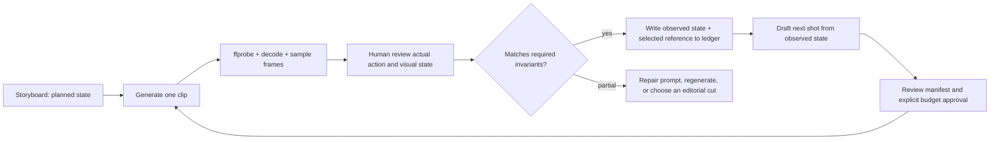

# Independent Technical Review — Muse Animation Studio

**Ngày review:** 2026-11-17  
**Phạm vi:** Audit độc lập kiến trúc, source, project demo, skills và khả năng Muse theo các tài liệu công khai tại ngày review.  
**Giới hạn:** Không sửa source hoặc dữ liệu project hiện có; không cài/chạy third-party skill; không đăng nhập Muse; không gọi generation, tạo video hay tiêu thụ quota. Mọi thông tin về dịch vụ có thể thay đổi cần kiểm tra lại trước khi triển khai.

## 1. Executive Summary

**Kiến trúc MVP khả thi cho pipeline có người duyệt ở từng shot; chưa đủ bằng chứng để cam kết sản xuất phim dài nhiều cảnh với continuity tự động.** Phân công Codex viết/đạo diễn, provider tạo clip, CLI lưu trạng thái và FFmpeg hậu kỳ là hợp lý. File-based storage, Python/Pydantic/Typer, provider boundary và ManualProvider phù hợp giai đoạn đầu; không cần dashboard hoặc database lúc này.

Project đã có một nền tảng hữu ích: demo 5 shot, Bible, các trạng thái dự kiến, ledger tách khỏi storyboard, manifest approval, provider thủ công và adapter Muse2API thử nghiệm. Nhưng đây là một **DRAFT workflow**, chưa phải video pilot: ledger còn trống, chỉ SHOT_001 có prompt, các shot C3 sau còn chờ xem clip trước, không có ảnh tham chiếu được duyệt và không có clip Muse hay MP4 đầu ra trong project. Điều này nhất quán với điều kiện generation hiện tại, nhưng chưa đạt Definition of Done của MVP nếu tính cả continuity và sản phẩm media. Xem [implementation plan](IMPLEMENTATION_PLAN.md), [demo episode](../projects/demo/episodes/EP001/episode.yaml), [continuity ledger](../projects/demo/episodes/EP001/continuity-ledger.yaml) và [manifest DRAFT](../projects/demo/episodes/EP001/generation/MAN-20261116T171034Z-db981b70.json).

Meta có công bố “Muse API” như một phần trong kế hoạch Meta Enterprise Platform; tuy nhiên, tại ngày review, tài liệu Meta Model API công khai mô tả image generation và video understanding, còn bài Muse Image vẫn nói Muse Video đang được phát triển. Không tìm thấy tài liệu công khai cho endpoint tạo video, duration, aspect ratio, reference-image semantics hay native continuation. Vì vậy không thể xem “Muse API” trong thông cáo doanh nghiệp hoặc Muse2API là bằng chứng rằng tài khoản này có thể tạo video qua API. [Meta Enterprise Platform](https://about.fb.com/news/2026/09/launching-meta-enterprise-platform/), [Meta Model API overview](https://dev.meta.ai/docs/overview), [Media understanding](https://dev.meta.ai/docs/media-understanding), [Muse Image announcement](https://about.fb.com/news/2026/07/introducing-muse-image-meta-ai/).

**Khuyến nghị:** bắt đầu bằng pilot 1 nhân vật, 1 địa điểm, 5 shot; giữ ManualProvider làm mặc định. Chỉ xem Muse2API là một giả thuyết tích hợp. Trước khi dùng gateway phải xác minh quyền truy cập trên chính tài khoản, điều khoản áp dụng, hành vi account selection và khả năng đo usage. Pilot cần hai clip liên tiếp được xem thực tế; shot thứ hai phải nhận frame tham chiếu cuối đã chọn từ clip thứ nhất, hoặc ghi rõ vì sao dùng cut/prompt-only. Chưa có cơ sở để hứa “liền mạch” hoặc scale sang tập dài.

## 2. Decision Audit

| Quyết định | Đánh giá | Bằng chứng | Khuyến nghị |
|---|---|---|---|
| Codex làm biên kịch/đạo diễn; Muse làm media provider; FFmpeg hậu kỳ | **PASS** | Trách nhiệm đã được tách rõ trong [AGENTS.md](../AGENTS.md); phù hợp với chức năng công khai của Muse Personal Agent, Muse Model API và FFmpeg. | Giữ nguyên; không coi Muse Personal Agent, Muse Code, Meta Model API và Muse Video là một sản phẩm/quota. |
| File project là nguồn sự thật; dùng Python, Pydantic, Typer, YAML/JSON và media trên đĩa | **PASS WITH CONDITIONS** | [Architecture](ARCHITECTURE.md) dùng file-based storage; dữ liệu demo hiện tách Bible, episode, ledger và manifest. | Giữ; thêm ghi file an toàn/atomic và kiểm tra chéo config–episode–Bible khi project lớn hơn hoặc có nhiều process. |
| Provider interface có capability, submit, poll và download | **PASS WITH CONDITIONS** | [VideoProvider](../src/animation_studio/providers/base.py) hỗ trợ bốn trách nhiệm đó; adapter trả trạng thái capability chưa live-verified. | Giữ boundary; capability phải gắn nguồn, ngày và kết quả probe. Coi `supports_* = true` từ static source audit là “được gateway khai báo/field tồn tại”, không phải account đã xác minh. |
| ManualProvider là mặc định | **PASS** | Cấu hình demo chọn `manual`, `verified_for_submission: false`; [implementation plan](IMPLEMENTATION_PLAN.md) nói rõ chưa có live generation. | Giữ mặc định cho tới khi có bằng chứng provider và user-approved thử nghiệm một shot. |
| Muse2API adapter | **UNKNOWN** | Adapter đã được kiểm thử bằng mock theo plan, nhưng không kiểm tra trên tài khoản hay gateway thật. Upstream tự mô tả là reverse-engineered web UI và có account pool/rotation; request của adapter không pin account. [Upstream README](https://github.com/czg86389-hub/muse2api/blob/main/README.md), [adapter](../src/animation_studio/providers/muse2api.py). | Không bật production. Chỉ xét lại nếu xác minh được quyền dùng, một account cố định, không rotation, usage quan sát được, vùng truy cập hợp lệ và probe được user duyệt. |
| Continuity Ledger giữ trạng thái quan sát tách khỏi storyboard | **PASS WITH CONDITIONS** | [Continuity spec](CONTINUITY_SPEC.md) và [continuity service](../src/animation_studio/core/continuity.py) yêu cầu review trước khi shot C3 tiếp theo chạy. Ledger demo chưa có observation nào. | Giữ nguyên nguyên tắc; thêm quy trình chọn frame cuối hợp lệ và đánh giá sai lệch cụ thể giữa planned/actual state. |
| FFmpeg/ffprobe cho render và QC | **PASS WITH CONDITIONS** | [media code](../src/animation_studio/media/ffmpeg.py) và [QC](../src/animation_studio/media/qc.py) kiểm tra stream, duration, decode, kích thước/FPS tùy chọn và xuất black segments. | Giữ; chuẩn hóa từng clip trước concat, quyết định audio duration rõ ràng, thêm kiểm tra âm thanh/subtitle/black-frame threshold và human visual review. |
| C3: đợi xem clip N rồi mới viết prompt N+1 | **PASS WITH CONDITIONS** | Đúng với [AGENTS.md](../AGENTS.md) và đang được áp dụng trong demo: prompt 2–5 để trống. | Giữ cho prompt cuối dùng để gửi provider. Tách thêm prompt-plan DRAFT để storyboard 5–8 shot vẫn có kế hoạch văn bản mà không giả rằng prompt đã sẵn sàng submit. |
| Third-party skills | **PASS WITH CONDITIONS** | Ba repo có giá trị ở các lớp khác nhau, nhưng format dữ liệu và provider/runtime khác project; chi tiết ở mục 3. | Không cài cả bộ. Giữ skill nội bộ; chỉ áp dụng có chọn lọc camera language, cross-document checks và QA; pin revision và giữ license/attribution nếu sao chép. |
| Sẵn sàng cho sản xuất tập dài nhiều cảnh | **FAIL (hiện tại)** | Chưa có clip thật, continuity evidence, usage basis, pipeline provider đã xác minh hoặc QC sản phẩm đầu-cuối. | Chỉ bắt đầu pilot có giới hạn; chưa coi bản hiện tại là production-ready hay long-form automation. |

## 3. Repository and Skills Audit

Các repository được xem qua README, skill entry point, các tài liệu chuyên môn có liên quan, cách cài đặt, manifest package và license hiển thị. Không clone, cài hoặc chạy code trong cuộc review này. README và nhánh `main`/`master` có thể thay đổi; trước khi import cần khóa commit/tag và xem lại toàn bộ file sẽ đưa vào project.

### 3.1 `zenstory-ai/drama-skills`

- **Phạm vi:** README mô tả 12 skill từ phân tích nguồn/story development đến script, assets, storyboard, prompt ảnh/video, production, edit và review. Skill storyboard kiểm tra visual basis, shot continuity và keyframe; video-prompt skill viết prompt chuyển động, camera, âm thanh, trạng thái đầu/cuối. Có checker để phát hiện lỗi liên tài liệu như shot duration lệch, nhân vật/đạo cụ trong prompt nhưng thiếu visual basis, hoặc reference ID không tồn tại. [README_EN](https://github.com/zenstory-ai/drama-skills/blob/main/README_EN.md), [storyboard skill](https://github.com/zenstory-ai/drama-skills/blob/main/skills/short-drama-storyboard/SKILL.md), [video-prompts skill](https://github.com/zenstory-ai/drama-skills/blob/main/skills/short-drama-video-prompts/SKILL.md), [checker examples](https://github.com/zenstory-ai/drama-skills/blob/main/docs/real-outputs_EN.md).
- **Giá trị:** ứng viên tốt nhất trong ba repo cho tiền kỳ: kịch bản, character/world/prop design, storyboard, camera coverage và continuity locks. Checker xác thực **tài liệu và khai báo reference**; không chứng minh video thực tế giữ được mặt, trang phục hoặc hành động.
- **Cấu trúc/runtime/license:** skills là `SKILL.md` kèm references/scripts; repo MIT. Script cần Python 3.9+; việc edit cần FFmpeg/ffprobe. README cài bằng `npx skills add ... -y -g`; bỏ `-g` để cài vào project hiện tại. [install instructions](https://github.com/zenstory-ai/drama-skills/blob/main/README_EN.md), [LICENSE](https://github.com/zenstory-ai/drama-skills/blob/main/LICENSE).
- **Tương thích:** Agent Skill frontmatter phù hợp với Codex. Creative source của repo là các file Markdown tiếng Trung theo schema riêng, không phải YAML/Pydantic của project này. Import nguyên bộ sẽ tạo nguồn sự thật thứ hai, tên file mới và workflow production riêng.
- **Đề xuất:** tham khảo/selectively port rubric về shot source, visual basis, continuity locks, prompt preview/approval và edit review. Giữ YAML project làm nguồn chính; tạo mapping/rubric tiếng Việt cho schema này, không duy trì song song bộ Markdown nếu chưa có lý do.

### 3.2 `masonmosen/muse-video-prompt-skill`

- **Phạm vi:** prompt sáu phần, nhiều đoạn, snapshot continuation, FFmpeg stitching và frame review. Skill gọi `media.generate_video`; tài liệu hướng dẫn truyền `resume_from_snapshot_id`, chia đoạn tối đa khoảng 10 giây, trích 3 frame và kiểm tra các điểm nối. [SKILL.md](https://github.com/masonmosen/muse-video-prompt-skill/blob/master/SKILL.md), [prompt template](https://github.com/masonmosen/muse-video-prompt-skill/blob/master/references/prompt-template.md), [stitch workflow](https://github.com/masonmosen/muse-video-prompt-skill/blob/master/references/stitch-workflow.md).
- **Giá trị:** hữu ích như prompt checklist (thời lượng, nhân vật, bối cảnh, beats, camera, âm thanh, hạn chế) và quy trình hậu kiểm. Skill tự nói không cam kết face-lock; README báo Muse built-in video bị 403 `video_not_available` ở môi trường maintainer khi kiểm tra 2026-11-05. Đây là trải nghiệm của tác giả, không phải probe tài khoản hiện tại. [README](https://github.com/masonmosen/muse-video-prompt-skill/blob/master/README.md), [model notes](https://github.com/masonmosen/muse-video-prompt-skill/blob/master/references/model-notes.md).
- **Cấu trúc/runtime/license:** MIT; script trích frame dùng Python standard library gọi `ffprobe`/`ffmpeg`, không phải API generation độc lập. [script](https://github.com/masonmosen/muse-video-prompt-skill/blob/master/bin/extract_frames.py), [LICENSE](https://github.com/masonmosen/muse-video-prompt-skill/blob/master/LICENSE).
- **Tương thích:** không tương thích trực tiếp với runtime hiện tại vì tool `media.generate_video` không có trong provider/CLI project. Tài liệu snapshot không được xác nhận bởi Meta Model API; request model Muse2API hiện được audit không có `snapshot_id`/continuation parameter. Mốc 10 giây là ghi nhận thực nghiệm riêng của skill, không nên hardcode thành thông số chính thức.
- **Đề xuất:** mượn prompt template và checklist cắt/kiểm tra; bỏ default tiếng Quan Thoại Đài Loan; không coi snapshot/10s là capability cho tới khi có docs hoặc test được duyệt trên đúng provider.

### 3.3 `svenkatreddy/universal-video-skills`

- **Phạm vi:** chín skill gồm prompt craft, cinematic direction, story-and-shots, character consistency, dialogue/audio, assembly, model adapters, QA và một workflow Veo trên Google Flow. Camera language và written frame-evidence QA phù hợp để bổ trợ skill nội bộ. [`README`](https://github.com/svenkatreddy/universal-video-skills), [cinematic direction](https://github.com/svenkatreddy/universal-video-skills/blob/main/skills/cinematic-direction/SKILL.md), [video QA](https://github.com/svenkatreddy/universal-video-skills/blob/main/skills/video-qa/SKILL.md), [model adapters](https://github.com/svenkatreddy/universal-video-skills/blob/main/skills/model-adapters/SKILL.md).
- **Giá trị:** tốt nhất cho ngôn ngữ quay phim, mô tả chuyển động, adapter prompts và checklist QA trung lập model. README tự ghi model notes có thể cũ; skill không tạo video. `muse-google-veo-web` nói về Google Flow/Veo, không phải Meta Muse.
- **Cấu trúc/runtime/license:** Agent Skills format, MIT. npm package yêu cầu Node `>=18`; `package.json` không khai báo package dependency. Installation guide dùng `npx skills add`. Repo có `scripts/` ngoài các thư mục skills; script không được cài/chạy hoặc audit dependency thực thi trong review này. [package.json](https://github.com/svenkatreddy/universal-video-skills/blob/main/package.json), [install guide](https://github.com/svenkatreddy/universal-video-skills/blob/main/docs/install.md), [LICENSE](https://github.com/svenkatreddy/universal-video-skills/blob/main/LICENSE).
- **Đề xuất:** chọn camera/QA references để cải thiện rubric project; không import Veo browser workflow. Trước khi dùng bất cứ script nào, đọc mã, dependencies và license liên quan; không lấy skill QA làm bằng chứng rằng nó tự động phát hiện lỗi nhận diện nếu chưa đánh giá script và dataset.

**Kết luận skills:** giữ `.agents/skills/anistudio-story-continuity` là router/source-local duy nhất. Tạo bảng mapping giữa YAML hiện tại và các kỹ thuật/rubric bên ngoài; pin commit; nếu copy file/script thì mang theo attribution và license. Không cài cả ba bộ vì nội dung trùng nhau ở shot design/prompt/continuity, khác schema và một số kỹ năng gắn với provider/runtime không tồn tại ở đây.

## 4. Muse Feasibility Report (kiểm tra ngày 2026-11-17)

### Đã xác minh bằng nguồn công khai

1. Meta công bố Muse Personal Agent là agent cá nhân chạy trong Muse Secure VM, triển khai ban đầu ở Hoa Kỳ; bài giới thiệu mô tả công việc/trợ lý agent, không mô tả API tạo video. [Meta announcement](https://about.fb.com/news/2026/09/introducing-muse-personal-ai-agent/).
2. Meta Model API công khai liệt kê Muse Wonder/Spark/Ember, Muse Image, voice transcription, SAM, image/video/audio understanding và Muse Code. Trang media understanding nói video input được xử lý để **trả về text** (mô tả/summary/transcription); Muse Image có endpoint tạo/chỉnh ảnh. Trong tài liệu đã xem không thấy video-generation endpoint. [Model API overview](https://dev.meta.ai/docs/overview), [media understanding](https://dev.meta.ai/docs/media-understanding), [Muse Image API guide](https://dev.meta.ai/docs/image-generation).
3. Ngày 2026-09-28 Meta thông báo Meta Enterprise Platform sẽ đưa “Muse API” tới doanh nghiệp/nhà phát triển. Thông cáo không nêu endpoint/schema video, availability cho tài khoản này hay liên hệ API đó với Muse Video; vì thế trạng thái là **ANNOUNCED, DETAILS/AVAILABILITY UNKNOWN**, không phải bằng chứng có video generation API. [Meta Enterprise Platform announcement](https://about.fb.com/news/2026/09/launching-meta-enterprise-platform/).
4. Bài ra mắt Muse Image tháng 7 mô tả Muse Video là đang phát triển. Đây là snapshot thông tin chính thức nhưng có thể thay đổi; nên recheck trước mỗi integration. [Muse Image announcement](https://about.fb.com/news/2026/07/introducing-muse-image-meta-ai/).
5. Meta Model API có cách đo/billing riêng: reasoning theo token, image theo ảnh, voice theo thời lượng audio, SAM theo frame/image. Tài liệu này không thiết lập rằng consumer “Additional Tokens” đổi được sang API billing hay dùng được trong gateway. [pricing](https://dev.meta.ai/docs/pricing-rate-limits).

### Chưa xác minh / UNKNOWN

| Khả năng | Kết luận hiện tại |
|---|---|
| Tài khoản người dùng có Muse Video hay không; vùng/quyền truy cập thực tế | **UNKNOWN** — không đăng nhập hoặc thử account trong review. Muse personal-agent announcement nêu rollout US, không xác nhận account này. |
| Muse Video chính thức có public API, endpoint, model ID hoặc capability tạo clip không | **NOT FOUND IN PUBLIC DOCS REVIEWED** — không kết luận rằng Meta sẽ không có API hay không có private/limited access. “Muse API” enterprise cần tài liệu/credential chính thức riêng. |
| Text-to-video/image-to-video, reference semantics, video continuation/snapshot, duration limits, aspect ratios, resolution | **UNKNOWN** với official public generation path; không có schema/documentation công khai trong tài liệu đã xem. |
| Muse2API gateway hoạt động với account này hay tạo clip thành công | **UNKNOWN** — chỉ static/mock contract test được ghi trong plan, chưa có request thật. |
| Một tỷ Additional Tokens từ referral được cấp hay không, hết hạn/cách dùng ra sao | **NOT VERIFIED** — không có tài liệu Meta công khai được tìm thấy trong nguồn đã xem để xác nhận campaign/referral. |
| Referral tokens có dùng cho Meta Model API hoặc qua Muse2API không | **NOT VERIFIED; không đưa vào usage estimate/budget.** Cùng tài khoản đăng nhập không chứng minh hai quota/billing surface liên thông. |

### Muse2API

Repo hiện mô tả mình là reverse-engineered API cho Muse web UI, bao gồm import cookies/session, account pool/rotation, browser/CDP và tác vụ video bất đồng bộ. README hiện tại cũng mô tả một số bảo vệ tài liệu tham chiếu và cấu hình gateway; những tính năng này là lời khai/code của bên thứ ba, không phải API contract Meta. [README](https://github.com/czg86389-hub/muse2api/blob/main/README.md), [app.py](https://github.com/czg86389-hub/muse2api/blob/main/app.py), [LICENSE](https://github.com/czg86389-hub/muse2api/blob/main/LICENSE).

Audit project ghi upstream commit `19db32a3d6ef50dc87567a8ee0e35dd50c8f7837`, version 1.6.11, nhưng đây là snapshot 2026-11-16. Upstream `main` có thể đã đổi từ đó. Adapter local chỉ kiểm tra field/request/task theo snapshot, chỉ gửi image/video reference, giới hạn file và từ chối URL ngoài loopback; không lưu cookie Muse và không tự retry POST. Nhưng adapter **không thể pin account ID hoặc bảo đảm gateway không chọn/đổi account**, không có continuation ID và chưa live-verified. Cấu hình hiện ghi provider mode manual, verify false, reference/duration support null: đây mới là tư thế đúng.

Meta Model API Terms hiện cấm một số hình thức cung cấp quyền truy cập Model API qua gateway/proxy và né quota/technical controls. Terms đó điều chỉnh việc dùng Meta Model API; **không đủ để kết luận phạm vi áp dụng chính xác đối với một gateway reverse-engineer consumer UI**. Cần xác minh điều khoản đúng của Muse consumer/enterprise service và nhận được cơ sở cho phép trước khi dùng gateway cho production. Đây là rủi ro contract/compliance cần giải quyết, không phải phán quyết pháp lý. [Meta Model API Terms](https://dev.meta.ai/legal/terms-of-service), [Model API AUP](https://dev.meta.ai/legal/acceptable-use-policy).

## 5. Continuity Architecture Review

### Phân biệt ba dữ liệu

- **Storyboard planned state:** ý đồ đạo diễn cho start/end pose, action beats, camera, props, lighting và geography. Chỉ là mục tiêu.
- **Observed media state:** điều thực sự thấy/nghe trong clip đã sinh sau khi mở/xem media và trích frame. Có thể lệch storyboard.
- **Continuity Ledger:** record có nguồn gốc cho observed state, frame path, timestamp, reviewer, sai lệch/rủi ro và handoff sang shot kế. Không được cập nhật bằng planned end state.

Spec và service hiện đã phân biệt hai loại state đúng cách: chỉ advance sau khi predecessor được review và có `actual_end_state`. Nhưng `record_review` chỉ yêu cầu đường dẫn first/middle/last frame; việc reviewer chọn frame đại diện, xác nhận nội dung và kiểm tra QA vẫn là quyết định bên ngoài code. Không có media đầu vào thì ledger trống là kết quả đúng, không phải bằng chứng continuity.

### Quy trình nối clip được khuyến nghị



| Kiểu tiếp nối | Ý nghĩa | Đánh giá cho Muse hiện tại |
|---|---|---|
| **A. Provider continuation/snapshot** | Provider nhận task/context/snapshot trước để tạo phần tiếp theo. | Tốt nhất nếu được tài liệu hóa và kiểm chứng. Muse2API request model được audit không có snapshot/continuation ID; skill riêng tuyên bố `resume_from_snapshot_id` nhưng không thay thế official docs. Hiện **không verified**, không được quảng cáo là có. |
| **B. Last-frame image reference** | Chọn frame cuối rõ từ clip N, gửi frame đó cùng prompt N+1. | Khả thi làm thử qua gateway nếu endpoint thật sự đưa ảnh vào model, nhưng tính năng field/reference chưa đồng nghĩa continuity được bảo đảm. Chưa live-verified ở account hiện tại. Đây là phương án ưu tiên để probe sau khi có quyền và approval. |
| **C. Prompt-only/edit continuity** | Mô tả lại trạng thái và dùng cut on action, match cut, establishing shot/cutaway để giấu discontinuity. | Fallback hiện có thể dùng trong ManualProvider. Đây là “prompt-only continuity”, không phải continuation kỹ thuật; phù hợp montage/cut, rủi ro cao với một cú đấm cần nối pose chính xác. |

### Handoff tối thiểu cho mỗi C3

1. Kiểm tra clip bằng ffprobe/decode; trích first/middle/last, đồng thời lấy thêm ứng viên trong 0.5–1 giây cuối. Không chọn máy móc `duration - 0.15s`: timestamp đó có thể rơi vào motion blur, fade, black frame, occlusion hoặc frame đã bắt đầu shot tiếp theo.
2. Reviewer chọn frame cuối thể hiện trạng thái hành động mà prompt mới phải tiếp tục; lưu nguyên frame, shot ID, timestamp, hash, task ID và lý do chọn. Nếu không có frame hợp lệ, ledger ghi rủi ro/lý do và shot tiếp theo đổi sang edit/cut hoặc regenerate.
3. So planned vs observed cho: nhận diện/ngoại hình, costume/accessories, vị trí và screen direction, eyeline, pose/action phase, trái/phải tay và prop state, geography/lighting, camera size/motion, audio/dialogue. Mark `pass / warn / fail` từng invariant; không gộp thành “continuity tốt”.
4. Prompt kế mô tả **việc cần xảy ra tiếp theo**, state thực tế đầu clip và hành động không được lặp. Nêu rõ frame reference nào điều khiển identity, costume, location hoặc composition. Reviewer xác nhận prompt trước manifest.
5. Khi có drift, sửa một nguyên nhân mỗi vòng: reference/phrase/camera/action beat; hoặc cut/regenerate. Ghi version, sai lệch và quyết định. Không tự đổi Bible/locks đã duyệt để hợp thức hóa một clip sai.

Prompt không thể bảo đảm nhận diện khuôn mặt, physics, đúng tay cầm props, hành động không bị lặp hay camera continuity nếu model/provider không có các điều khiển đó. Có thể thêm computer vision sau này để đề xuất mismatch, nhưng đo embedding hoặc hỏi model vision không phải ground truth; human review vẫn là gate MVP.

## 6. Security and Cost Risk Assessment

| Mức | Rủi ro | Vì sao | Kiểm soát khuyến nghị |
|---|---|---|---|
| **High** | Cookie/session bị lộ qua gateway reverse-engineered | Cookie Muse tương đương credential tài khoản; upstream lưu account/session; browser import/CDP làm tăng bề mặt tin cậy. | Không đăng nhập/import trong bước audit; nếu sau này xét dùng thì account riêng nếu điều khoản cho phép, bảo vệ data dir/host, không commit/log cookie, rotate/revoke sau thử nghiệm. |
| **High** | Không kiểm soát account selection/rotation | Muse2API quảng cáo account pool/rotation; adapter local không gửi account pin và không thể chứng minh gateway chỉ dùng một account. Có thể vi phạm nguyên tắc project “không né usage controls” hoặc làm usage attribution sai. | Không bật cho production nếu chưa chứng minh cấu hình single-account, rotation tắt và request/task được ghi nhận cùng account; không dùng nhiều account để né limit. |
| **High** | Publicly exposed gateway/admin plane | README có cấu hình host/networking và CORS wildcard trong app; bearer key là cửa bảo vệ API. Nếu bind ra mạng, key/session và các thao tác admin có thể bị khai thác tùy cấu hình. | Chỉ loopback trên máy tin cậy; không expose Internet/LAN; secret ngoài project; firewall; không chép admin URL/query key vào log/share. |
| **High** | Phụ thuộc một giao diện web chưa chính thức | Web UI, session, selectors và policy có thể đổi hoặc bị giới hạn theo region/account. Static/mocked tests không chứng minh video thật. | Manual fallback; version pin; one-shot probe đã duyệt; stop khi 401/403/429/schema change; không retry POST mù. |
| **Medium** | Usage/budget không có cơ sở đo | Manifest approval yêu cầu estimate/cap, nhưng field là text tự khai; gateway scrape quota không phải billing contract chính thức. Tỷ lệ conversion của referral không biết. | Không điền estimate giả; tách actual usage pre/post, nguồn và đơn vị; không approve khi unknown; giới hạn mỗi request. |
| **Medium** | File jobs/ledger ghi tuần tự, không có coordinator nhiều process | Đơn giản/restart-friendly cho một CLI, nhưng ghi file trực tiếp; concurrent CLI/crash có thể tạo trạng thái dở hoặc race. | Một writer trong MVP; atomic temp+replace, project lock và recovery/checksum khi cần song song. Không cần DB ngay. |
| **Medium** | QC kỹ thuật bị hiểu nhầm thành QC sáng tạo | Black segments chỉ được report, không tác động status; không có kiểm tra identity/action/audio clipping/subtitle timing hoặc mắt người. | Đặt tên kỹ thuật rõ; thêm contact sheet, threshold rules và report review của người. |
| **Low** | FFmpeg/path/local media | Tool chạy subprocess và media có thể lớn; đường dẫn sai hoặc nguồn không đáng tin có thể gây lỗi/disk pressure. | File size cap hiện có; confined project path, output riêng, kiểm tra input/container và disk trước render. |

**Không xếp Critical** vì workflow hiện không tự submit, dùng manual mặc định, approval fingerprint và giới hạn loopback. Rủi ro có thể thành critical nếu bỏ các gate hoặc lộ session/admin key.

## 7. Architecture Improvements

1. **Giữ ba lớp state:** `planned_state`, `actual_observation`, `next_shot_handoff`. Handoff phải lưu frame path/hash/timestamp, source provider/task, reviewer, confidence/risk và action continuation/non-repeat.
2. **Tách prompt-plan khỏi prompt-submit.** Cho phép 5–8 prompt outline DRAFT để đọc trọn tập; prompt submit của C3 chỉ đóng băng sau review clip predecessor. Manifest chỉ nhận prompt submit-ready.
3. **Đưa capability về `unknown` cho tới khi có evidence.** Mỗi provider capability nên có `source`, `checked_at`, `provider_version`, `account/region scope`, `probe status`; static source có field không được đánh dấu live verified.
4. **Bổ sung preflight chéo tài liệu:** project/episode visual style và ratio, Bible IDs/locks, reference file tồn tại/MIME, shot fields không còn `unspecified`, đúng duration/camera/audio/QA, dependency và reference cho C3. Demo hiện có diễn đạt visual style khác nhau giữa `project.yaml` và `episode.yaml`; bibles chưa có reference image path.
5. **Provider reliability:** giữ no-retry trên uncertain POST; đặt deadline và polling interval/backoff cho GET; lưu `submitted_at`, task ID, request hash, adapter/gateway version, terminal state và download hash. Recovery phải resumable sau process restart. Không bật concurrency cho C3.
6. **Safe project writes:** atomic write + single-writer/project lock để CLI interruption/concurrent invocation không làm hỏng `jobs.json` hoặc ledger. File-based vẫn đủ; chưa cần database.
7. **Media pipeline:** normalize từng clip về codec, pixel format, resolution, FPS, timebase, SAR và audio layout trước concat. Chọn chính sách rõ cho nhạc/audio dài hơn picture (trim/pad/mix + `-shortest` hoặc duration target); kiểm tra subtitle sync. Hậu kỳ re-encode không khắc phục được mọi lỗi stream incompatibility ở bước concat đầu vào.
8. **QC nhiều tầng:** technical (ffprobe, decode, expected stream/duration, black/silence/audio clipping), editorial (shot order, cut boundary, subtitle/audio), creative (identity/costume/action/pose/geography/camera) và final human playback. Nếu blackdetect trả segment thì QC phải đánh dấu theo threshold đã cấu hình thay vì chỉ lưu list.
9. **Usage ledger:** planned estimate có nguồn và phạm vi; actual request count/retries/usage before-after, currency/credits/token type; unknown là trạng thái hiển thị, không thay bằng zero. Consumer token/referral không được chuyển đổi sang API credit nếu chưa có documentation.
10. **Không thêm dashboard/DB/model vision trong phase đầu.** Cải thiện validator/manifest/ledger và contact sheets trước; automation nâng cao chỉ thêm khi pilot cho thấy bottleneck.

## 8. Recommended Final Architecture

```text
Codex + local project skill
  └─ Script / bibles / storyboard / prompt-plan (DRAFT)
      └─ Python CLI (Pydantic validation, manifest, approvals, durable job records)
          └─ ManualProvider (default; user controls Muse UI)
             └─ [optional, gated] provider adapter with verified capabilities
                 └─ one shot at a time → media import/download + hashes
                     └─ ffprobe/decode + frames/contact sheet
                         └─ human creative QA → observed Continuity Ledger
                             └─ next C3 sendable prompt from actual state
                                 └─ FFmpeg normalize/assemble/audio/subtitle
                                     └─ technical + editorial + human final QC report
```

**Provider order:** ManualProvider first. Official Meta Model API may be useful for documented Muse Spark video understanding or Muse Image assets, but it is not currently an official video-generation integration in public docs reviewed. Muse2API remains optional, disabled, local-only and not a production assumption; include only if access/terms, account pinning, usage visibility and one approved video pilot are verified. Preserve provider interface so a documented official video endpoint or another authorized model can later replace the gateway without changing the continuity ledger.

## 9. MVP Implementation Plan

### Phase 0 — Research and feasibility

- Freeze a dated evidence note for official Muse API vs Personal Agent vs Muse Code vs Muse Video vs enterprise “Muse API”. Re-check Meta docs, geographic use, service terms, video endpoint/schema and price/usage measurement.
- On a future authorized session, user manually verifies whether their account and region show video generation and how UI reports usage. This review did not log in or use tokens.
- Decide `Manual only` if API/terms/usage are unclear. Do not configure a gateway until it can be held to one account without rotation.

### Phase 1 — Skill integration

- Keep the project-local skill and YAML source of truth.
- Select camera vocabulary and shot-QA rubric from Universal Video Skills; select story/visual-basis cross-document checks from Drama Skills.
- Pin exact commits and preserve attribution/LICENSE if copying. Add no installation dependency until the files/scripts have been read and the schema mapping is agreed.

### Phase 2 — Script and storyboard

- Complete one character, one location, one key prop and 5 planned shots. Resolve style wording into one canonical project/episode source.
- Populate every required field: start/end pose, hand/prop, screen direction, action beats, camera, lighting, audio, reference plan, QA invariants and continuity severity. Remove `unspecified` from any approved shot.
- Store 5 prompt-plan drafts; mark C3 prompts as not submit-ready until actual predecessor review. Add approved reference image or explicitly record text-only risk.

### Phase 3 — Provider integration

- Keep ManualProvider as the launch route. Prepare one-shot manifest with exact prompt, ratio/duration, actual references, provider and a usage cap.
- A real provider test is a separate future action requiring user approval of that concrete manifest and cap. Test one shot only; record model/provider, task ID, timestamps, parameters, output hash, usage before/after and failure state.
- If Muse2API remains a candidate, verify single-account/no-rotation at gateway configuration/code level before submission; no automatic POST retry; stop on session/access failure. If this cannot be proven, do not use it.

### Phase 4 — Continuity engine

- Import clip, hash, probe and extract first/middle/last plus tail candidates.
- Human selects an end frame and records actual end state, known errors and required locks. Compare storyboard vs media explicitly.
- Only then unlock next C3 prompt. If reference support is absent or clip diverged, repair/regenerate or convert the edit plan to a justified cut; mark continuity mode/risk accurately.

### Phase 5 — FFmpeg assembly and QC

- Normalize shot streams before concat; implement explicit audio/subtitle length policy.
- QC report includes decoded MP4, streams/codecs, duration, dimensions/FPS, black segments with thresholds, audio/subtitle checks and boundary contact sheets.
- Human reviews creative continuity, not only ffprobe output; store report and output hash.

### Phase 6 — End-to-end pilot

- Plan 5–8 shots, but authorize only two sequential connected generations for the first proof. The second request uses the selected actual final frame of the first if image-reference is verified; otherwise use a planned edit boundary and state the limitation.
- **PASS:** both outputs are real provider media; task/usage provenance is complete; frame handoff is present or explicit cut rationale is recorded; identity/costume/props/geography and action transition pass the agreed human rubric; MP4 decodes, target streams and duration are within predeclared tolerances; QA report and observed ledger exist; spend stayed within the approved cap.
- **FAIL:** access/usage cannot be verified; clip 2 repeats or skips the required action; key identity/costume/prop/geography mismatches; reference was not actually sent/accepted; MP4 fails decode or required streams are absent; QC/usage is missing; or requests exceeded the approved manifest/cap.
- After the two-shot gate passes, finish remaining shots sequentially. A 5–8-shot draft alone is not evidence of long-form scalability.

## 10. Final Verdict

### Có nên bắt đầu dự án chưa?

**Có — bắt đầu pilot có người duyệt, chưa bắt đầu production automation dựa vào Muse Video.** Phần kiến trúc nội bộ đủ hợp lý để tiếp tục bằng ManualProvider và một pilot có phạm vi hẹp. Provider thật chỉ được bật sau khi xác minh account, quyền sử dụng, capability và ngân sách cho manifest cụ thể.

### Ba rủi ro lớn nhất

1. **Muse access/API không được chứng minh:** tài liệu Meta hiện chưa cho thấy public video-generation API; account/regional availability và continuation/reference semantics còn unknown.
2. **Muse2API là gateway cộng đồng dùng session web và account pool:** bảo mật/điều khoản/rotation/usage attribution chưa thể tin cậy cho production, và adapter không pin account.
3. **Continuity và QC hiện chủ yếu là human process:** ledger/schema chuẩn bị đúng khái niệm nhưng chưa có output thực tế, frame chọn tự động chưa được đánh giá, QC code đo media kỹ thuật mà chưa quyết định creative pass.

### Điều cần giải quyết trước khi triển khai generation

- Xác minh nguồn truy cập chính thức hoặc chấp nhận rõ rủi ro gateway; account/region và terms.
- Đo usage thật trên một request nhỏ do người dùng duyệt; không tính referral token vào estimate khi chưa có bằng chứng.
- Cố định profile one-account/no-rotation nếu gateway được xem xét.
- Hoàn thiện shot fields, approved reference plan, prompt-plan vs sendable prompt distinction và PASS/FAIL rubric.

### Nên giữ và thay đổi

- **Giữ:** ManualProvider mặc định; file-based project; Python/Pydantic/Typer; status gates; approval manifest; no automatic POST retry; planned/observed state separation; C3 sequential; FFmpeg/ffprobe; chưa xây dashboard/database.
- **Thay đổi/bổ sung:** capability evidence có ngày/phạm vi; cross-document validation; immutable actual-state provenance và chọn frame cuối hợp lệ; safe atomic job writes; stream normalization/audio duration policy; QC tạo báo cáo nhiều tầng; phân tách draft prompts khỏi prompt được phép submit.
- **Không tuyên bố:** đã có Muse video API, account đã có quyền, referral tokens dùng được qua gateway, native snapshot continuation có sẵn, video liên tục hoàn hảo hoặc MVP media hoàn thành. Tại ngày review, các điều đó chưa được xác minh.

## Sources and review record

- Project source/docs được đọc tại workspace ở ngày 2026-11-17. Chi tiết kiến trúc hiện có: [AGENTS.md](../AGENTS.md), [RESEARCH_NOTES.md](RESEARCH_NOTES.md), [CONTINUITY_SPEC.md](CONTINUITY_SPEC.md), [ARCHITECTURE.md](ARCHITECTURE.md), [GENERATION_SAFETY.md](GENERATION_SAFETY.md), [IMPLEMENTATION_PLAN.md](IMPLEMENTATION_PLAN.md), [THIRD_PARTY_SKILLS.md](THIRD_PARTY_SKILLS.md).
- Nguồn Meta và GitHub bên thứ ba được mở/đối chiếu công khai ngày review; nhánh chính có thể đổi sau ngày đó. Không dùng số stars làm tiêu chí.
- Không chạy test trong cuộc review read-only này. Implementation plan ghi nhận 37 unit tests pass và kiểm tra static/fixture pass; đây là kết quả đã ghi trong project, không phải kết quả được chạy lại ở review này. Các kiểm tra đó không xác minh provider/account thật.
- Không cài skill, không đăng nhập, không gửi request tạo media, không dùng token và không sửa file project/source hiện có.
